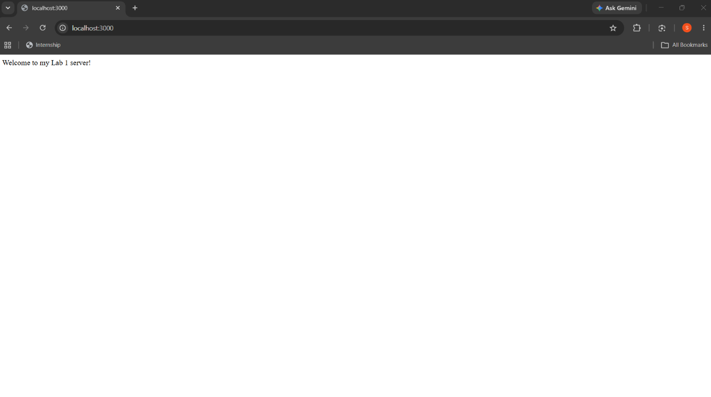
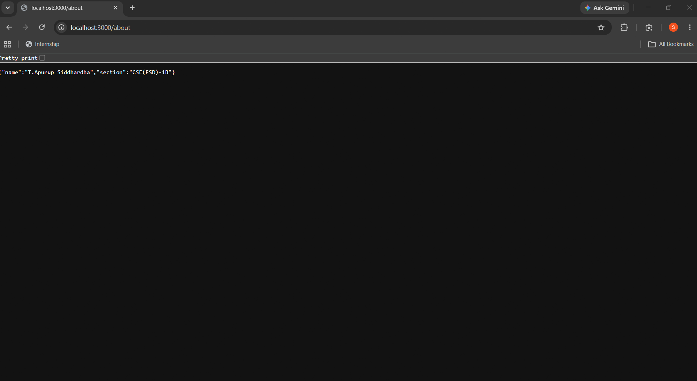
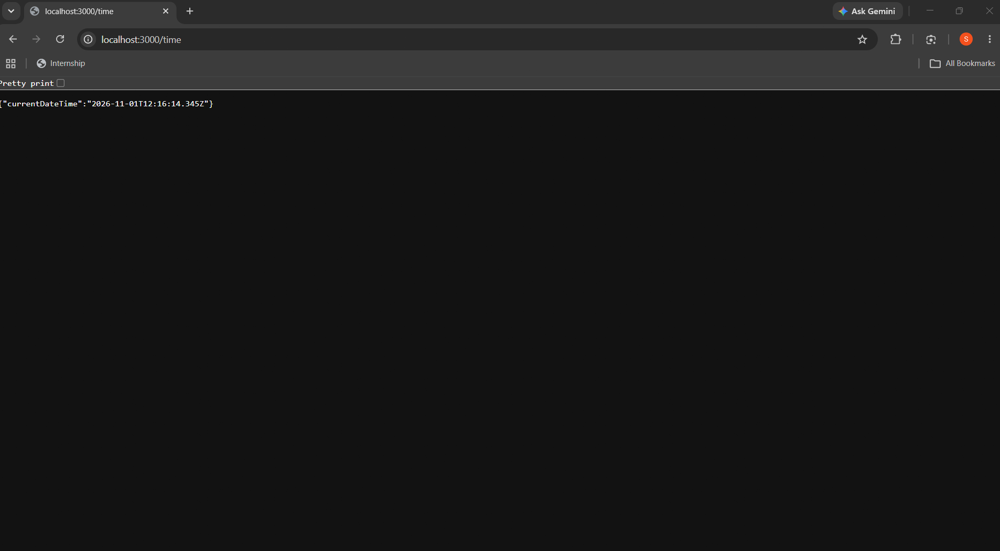

 # Lab 1: Node.js and Express Server

## Student Details

- **Name:** T.Apurup Siddhardha
- **Registration Number:** 252U1R7091
- **Section:** CSE(FSD)-1B
- **Course:** Backend Development Fundamentals
- **Lab Number:** 01

## Live Link

https://express-js-lab-1.vercel.app/

## Objective

To set up a Node.js project using `npm`, understand the role and structure of `package.json`, create a basic HTTP server using Node.js's built-in `http` module, and build an Express server handling multiple routes with appropriate HTTP status codes and error responses.

## Technologies Used

- **Node.js:** Server-side JavaScript runtime environment
- **Express.js:** Minimal and flexible web application framework for Node.js
- **JavaScript (ES6+):** Programming language used for server implementations
- **npm:** Package manager used for dependency management and scripts
- **Visual Studio Code:** Integrated development environment

## Project Structure

```text
lab-01/
├── screenshots/
│   ├── home.png
│   ├── about.png
│   ├── time.png
│   └── not-found.png
├── server-http.js
├── server.js
├── package.json
├── package-lock.json
├── .gitignore
└── README.md
```

## `package.json` Configuration

The `package.json` file serves as the manifest for the Node.js project. Key fields explained:

- **`name`:** The identifier of the project (`lab-01`).
- **`version`:** The current semantic version of the application (`1.0.0`).
- **`description`:** A brief summary explaining the purpose of the project.
- **`main`:** The primary entry point file of the application (`server.js`).
- **`scripts`:** Command shortcuts defined for project workflows:
  - `npm start`: Runs the Express server (`node server.js`).
  - `npm run start:http`: Runs the basic HTTP server (`node server-http.js`).
  - `npm test`: Test script placeholder.
- **`keywords`:** Array of descriptive tags for searching and indexing.
- **`author`:** The developer's name (`T.Apurup Siddhardha`).
- **`license`:** License type under which the code is distributed (`ISC`).
- **`dependencies`:** Lists external packages required for runtime execution (e.g., `express`).

## Installation and Setup

### Prerequisites

- Node.js (v18 or higher recommended; v24 tested)
- npm (Node Package Manager)
- A web browser (e.g., Microsoft Edge, Google Chrome) or API client (e.g., cURL, Postman)

### Steps to Run

1. Open the project folder in your terminal:
   ```bash
   cd express.js_lab_1
   ```

2. Install dependencies:
   ```bash
   npm install
   ```

3. Start the Express application server:
   ```bash
   npm start
   # or: node server.js
   ```

4. Open your browser and navigate to:
   ```text
   http://localhost:3000
   ```

### How to Run the Basic HTTP Server

To test the server built using Node.js's native `http` module:

1. Stop any server currently running on port 3000 (`Ctrl + C`).
2. Run the HTTP server:
   ```bash
   npm run start:http
   # or: node server-http.js
   ```
3. Open `http://localhost:3000` in your browser. The response will be the plain text message:
   ```text
   Hello
   ```

> **Note:** Always stop the running server with `Ctrl + C` before starting another server on the same port to avoid port conflict errors (`EADDRINUSE`).

## Endpoints

| Method | Endpoint | Description | Expected Status |
|---|---|---|---|
| GET | `/` | Welcome message | 200 OK |
| GET | `/about` | Student name and section in JSON | 200 OK |
| GET | `/time` | Current date and time | 200 OK |
| GET | `/anything` | Unknown route demonstration | 404 Not Found |

> **Note on Unknown Routes:** The `/anything` route is an example of an undefined route. All routes not explicitly handled by the application will return a `404 Not Found` HTTP status with the message `404 - Page Not Found`.

## Testing Routes

You can verify each route using cURL or your browser:

1. **Home Route (`GET /`):**
   ```bash
   curl -i http://localhost:3000/
   ```
   *Expected Response:* Status `200 OK`, `Welcome to my Lab 1 server!`

2. **About Route (`GET /about`):**
   ```bash
   curl -i http://localhost:3000/about
   ```
   *Expected Response:* Status `200 OK`, JSON object `{"name":"T.Apurup Siddhardha","section":"CSE(FSD)-1B"}`

3. **Time Route (`GET /time`):**
   ```bash
   curl -i http://localhost:3000/time
   ```
   *Expected Response:* Status `200 OK`, JSON object containing `currentDateTime` ISO timestamp.

4. **Unknown Route (`GET /anything`):**
   ```bash
   curl -i http://localhost:3000/anything
   ```
   *Expected Response:* Status `404 Not Found`, `404 - Page Not Found`

## Screenshots

### 1. Home Route

Displays the welcome message with HTTP status `200 OK`.



### 2. About Route

Displays student name and section in JSON format with HTTP status `200 OK`.



### 3. Time Route

Displays the current date and time in JSON format with HTTP status `200 OK`.



### 4. Unknown Route

Displays the 404 Not Found response when accessing an undefined route.


## HTTP Status Codes

- **200 OK:** Standard response for successful HTTP requests. Returned by `/`, `/about`, and `/time`.
- **404 Not Found:** Standard response indicating that the server cannot find the requested resource. Returned by all undefined routes (e.g., `/anything`).

## Viva Questions and Answers

### 1. What is the difference between `package.json` and `node_modules`?
- **`package.json`:** A lightweight manifest file that lists metadata about the project, project scripts, and names/version ranges of required dependencies. It is committed to version control.
- **`node_modules`:** The actual directory containing all the installed third-party library files and transitive dependencies downloaded by npm. It is large and should never be committed to version control (added to `.gitignore`).

### 2. What does `app.listen()` do?
`app.listen()` binds and listens for incoming HTTP connections on the specified host and port. It starts the Node.js event loop listening for network requests dispatched to Express route handlers.

### 3. What do request and response represent?
- **`request` (`req`):** An object representing the incoming HTTP request, containing request headers, query parameters, URL path, HTTP method, and body payload sent by the client.
- **`response` (`res`):** An object used to construct and send the HTTP response back to the client, allowing the developer to set HTTP status codes, response headers, and send data (HTML, plain text, JSON, etc.).

## Problems Faced and Solutions

1. **PowerShell Script Execution Policy Restriction:**
   - *Problem:* Running `npm init -y` or `npm install` directly in PowerShell caused an execution policy error: `PSSecurityException: File C:\Program Files\nodejs\npm.ps1 cannot be loaded because running scripts is disabled on this system`.
   - *Solution:* Executed commands via `npm.cmd` (e.g., `npm.cmd install express`) or through `cmd.exe /c npm`, avoiding the restricted `.ps1` execution policy while maintaining full npm functionality.

2. **Port Conflict (`EADDRINUSE: address already in use :::3000`):**
   - *Problem:* Attempting to run `server.js` while `server-http.js` was still actively running resulted in port collision because both servers default to port 3000.
   - *Solution:* Ensured that any running server instance was properly stopped using `Ctrl + C` or terminating the process before starting the other server, and checked port availability with `Get-NetTCPConnection`.

## Git and Repository Notes

- The `.gitignore` file excludes `node_modules/` and `.env` to prevent committing unnecessary dependencies and sensitive environment data.
- The `node_modules/` directory must not be tracked or committed to Git.
- Screenshots are stored under `screenshots/` and referenced relatively in this document.
