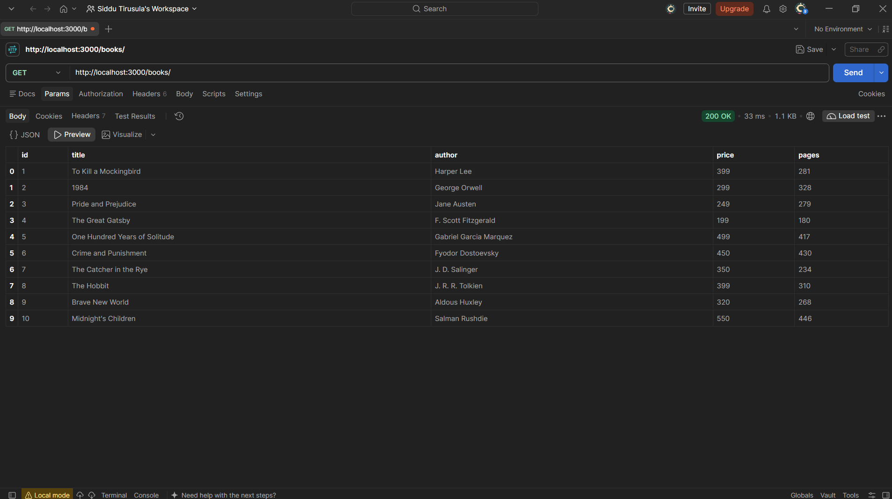
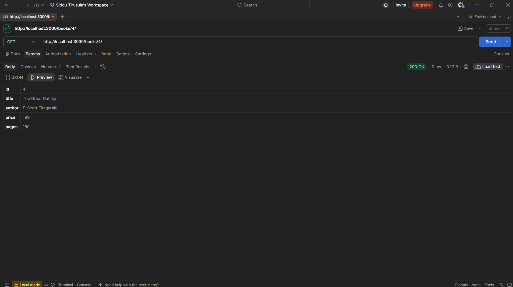
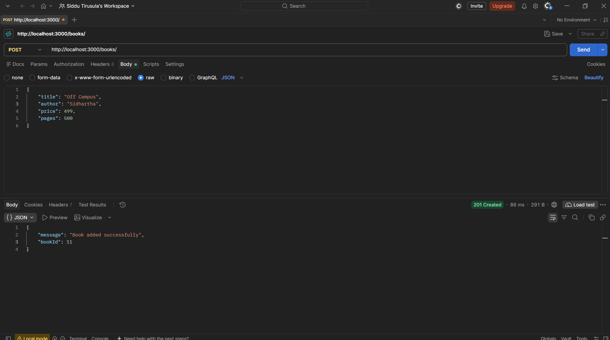
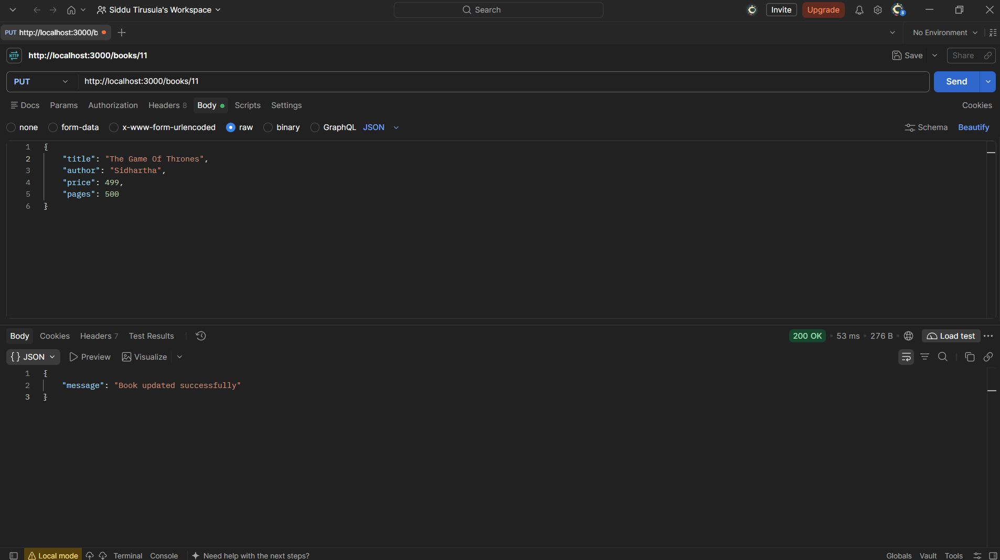
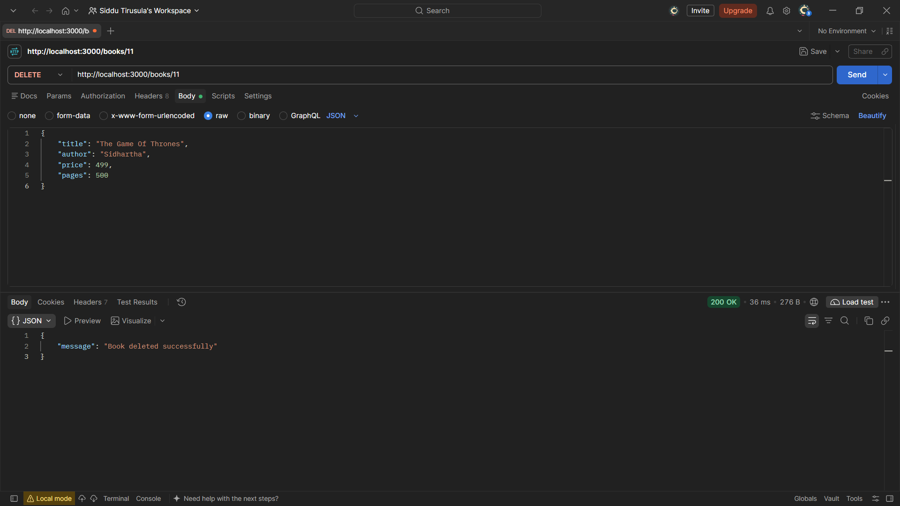
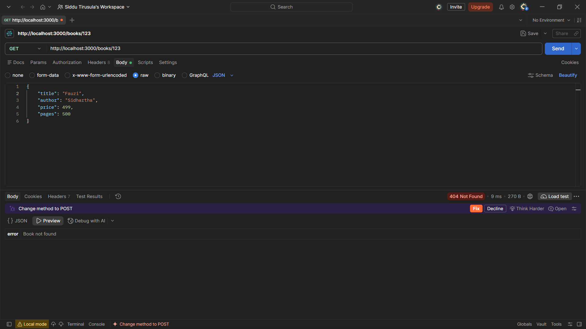

# Lab 2: SQLite database and CRUD routes

## Student Details

- **Name:** T. Apurup Siddhardha
- **Registration Number:** 252U1R7091
- **Section:** CSE FSD - [2B]
- **Course:** Backend Development Fundamentals
- **Lab Number:** 02

## Live Link

- **Deployment Status:** Deployment pending.
- **Platform Analysis & Technical Rationale:**
  - Traditional serverless platforms (such as Vercel) deploy Express routes as stateless serverless functions operating over an ephemeral, read-only file system. Because SQLite requires a writable local filesystem, any write operation (`INSERT`, `UPDATE`, `DELETE`) fails or is wiped out on container re-initialization. Furthermore, native C++ bindings for `sqlite3` frequently encounter compilation incompatibilities in serverless function environments.
  - Recommended host: **Render** (Web Service). Render provisions a persistent Node.js runtime process that executes `server.js` continuously. Note that on Render's free tier, the service spins down after 15 minutes of inactivity (causing an initial 50-second wake-up delay), and container restarts will reset disk state unless a persistent disk volume is mounted.
  - Live deployment is kept pending awaiting deployment authorization. The application is fully prepared for cloud deployment using `process.env.PORT || 3000`.

## Objective

Connect an Express server to a SQLite database and expose create, read, update, and delete (CRUD) operations over HTTP, ensuring strict query parameterization with `?` placeholders to prevent SQL injection and returning standard HTTP status codes.

## Technologies Used

- **Node.js:** Server-side JavaScript runtime environment (tested on v24.16.0)
- **Express.js (v4.19.2):** Web framework for handling HTTP routing, middleware, and JSON parsing
- **SQLite3 (v5.1.7):** SQLite client library with native asynchronous database bindings
- **sqlite (v5.1.1):** Promise-based wrapper around sqlite3 facilitating clean `async/await` syntax
- **nodemon (v3.1.0):** Development monitoring utility that automatically restarts the node process on file modifications
- **JavaScript (ES6+):** Language for asynchronous database and server logic
- **npm:** Package manager for dependency and script lifecycle management

## Project Structure

```text
express.js_2/
├── screenshots/
│   ├── cli-before.png
│   ├── get-all.png
│   ├── get-one.png
│   ├── post.png
│   ├── put.png
│   ├── delete.png
│   ├── not-found.png
│   └── cli-after.png
├── books.db
├── package.json
├── package-lock.json
├── seed.sql
├── server.js
├── .gitignore
└── README.md
```

## `package.json` Fields Explained

The `package.json` file serves as the manifest and configuration file for the Node.js project:

- **`name`:** Identifier of the application (`lab-02`).
- **`version`:** Current semantic version of the project (`1.0.0`).
- **`description`:** Summary of the assignment objective and features.
- **`main`:** The primary entry point file of the application (`server.js`).
- **`scripts`:** Workflow shortcuts for running and developing the server:
  - `npm start`: Starts the application in production mode (`node server.js`).
  - `npm run dev`: Starts the application with live-reloading during development (`nodemon server.js`).
- **`keywords`:** Array of descriptive keywords for cataloging (`nodejs`, `express`, `sqlite`, `sqlite3`, `crud`, `backend`, `lab-02`).
- **`author`:** The student's name (`T. Apurup Siddhardha`).
- **`license`:** Software license for the codebase (`ISC`).
- **`dependencies`:** Runtime libraries required by the server:
  - `express`: Core web application framework.
  - `sqlite`: Async/await wrapper for SQLite.
  - `sqlite3`: Native SQLite database driver.
- **`devDependencies`:** Development-only tools:
  - `nodemon`: Automatic server restart utility on code changes.

## Installation and How to Run

### Prerequisites

- Node.js (v18 or higher recommended; v24 tested)
- npm (Node Package Manager)

### Steps to Run

1. Open your terminal in the project directory:
   ```bash
   cd express.js_2
   ```

2. Install project dependencies:
   ```bash
   npm install
   ```

3. Ensure the SQLite database `books.db` is built from `seed.sql`:
   ```bash
   # Rebuild database via SQLite CLI:
   sqlite3 books.db < seed.sql
   ```
   *(If sqlite3 CLI is not installed globally, run the helper command: `node -e "const fs=require('fs'),s3=require('sqlite3').verbose(),db=new s3.Database('books.db');db.exec(fs.readFileSync('seed.sql','utf8'),()=>db.close());"`)*

4. Start the server:
   ```bash
   npm start
   # or for auto-reload during development:
   npm run dev
   ```

5. The server will bind and listen on:
   ```text
   http://localhost:3000
   ```

## Database

The application manages data inside a local SQLite database file named `books.db`.

### Table Schema

The database contains a single table named `book`:

```sql
CREATE TABLE book (
  id INTEGER PRIMARY KEY,
  title TEXT,
  author TEXT,
  price INTEGER,
  pages INTEGER
);
```

### How to Rebuild with `seed.sql`

The `seed.sql` file defines the schema and inserts 10 sample books. To rebuild the database from scratch:

```bash
sqlite3 books.db < seed.sql
```

### How to Inspect with SQLite CLI

To inspect table contents directly from the command line:

```bash
sqlite3 books.db
.headers on
.mode column
SELECT * FROM book;
.exit
```

## Endpoints

### CRUD Routes

| Method | Path | Description | Success Status |
|---|---|---|---|
| GET | `/books/` | Retrieves array of all books | 200 OK |
| GET | `/books/:bookId/` | Retrieves a single book by ID | 200 OK |
| POST | `/books/` | Adds a new book from the JSON body | 201 Created |
| PUT | `/books/:bookId/` | Updates all fields of an existing book | 200 OK |
| DELETE | `/books/:bookId/` | Deletes a book by ID | 200 OK |

> **Trailing Slash Flexibility:** Routes are configured to resolve identically with or without a trailing slash (e.g., both `/books` and `/books/`, `/books/:bookId` and `/books/:bookId/`).

### Request Body Format (POST & PUT)

```json
{
  "title": "Brave New World",
  "author": "Aldous Huxley",
  "price": 320,
  "pages": 268
}
```

### Error Responses

| Scenario | HTTP Status | Response Example |
|---|---|---|
| `bookId` is not a positive whole number (e.g., `abc`, `-1`, `0`, `1.5`) | 400 Bad Request | `{"error": "bookId must be a positive whole number"}` |
| Missing or invalid field in JSON request body | 400 Bad Request | `{"error": "Field 'title' is required and must be a non-empty string"}` |
| Malformed JSON syntax in request body | 400 Bad Request | `{"error": "Malformed JSON payload in request body"}` |
| Book ID does not exist in database (`GET`, `PUT`, `DELETE`) | 404 Not Found | `{"error": "Book not found"}` |
| Undefined or unknown route requested | 404 Not Found | `{"error": "404 - Route not found"}` |
| Unexpected database error | 500 Internal Server Error | `{"error": "Internal server error"}` |

### Security Note: Parameterized Queries

Every query incorporating request input (`bookId`, `title`, `author`, `price`, `pages`) strictly utilizes SQL `?` parameter placeholders. Dynamic query string concatenation is forbidden, guaranteeing complete protection against SQL injection attacks.

## Screenshots

### 1. Database Before Testing (SQLite CLI)
Displays the initial 10 records loaded into `books.db` prior to running test operations.


### 2. GET All Books
Retrieves the complete list of books with HTTP status 200 OK.


### 3. GET One Book
Retrieves a specific book by ID with HTTP status 200 OK.


### 4. POST Add Book
Inserts a new book into the database and returns HTTP status 201 Created with the generated book ID.


### 5. PUT Update Book
Completely updates all fields of an existing book with HTTP status 200 OK.


### 6. DELETE Book
Removes a book record by ID and returns HTTP status 200 OK.


### 7. Book Not Found (404 Error Case)
Demonstrates the 404 Not Found response when querying a non-existent book ID.


### 8. Database After Testing (SQLite CLI)
Displays the database state showing the persisted updates and modifications after test execution.


## HTTP Status Codes

- **200 OK:** Returned when a GET, PUT, or DELETE request succeeds.
- **201 Created:** Returned when a POST request successfully creates a new book record in the database.
- **400 Bad Request:** Returned when client input fails validation (non-positive book ID, missing required fields, or malformed JSON).
- **404 Not Found:** Returned when the requested book ID does not exist or when an undefined URL route is accessed.
- **500 Internal Server Error:** Returned if an unhandled internal exception or unexpected database failure occurs.

## Viva Questions and Answers

### 1. What is SQL injection and how do `?` placeholders prevent it?
- **SQL Injection:** A vulnerability where an attacker supplies malicious SQL code into input fields (e.g., `' OR 1=1 --`), which gets concatenated directly into an SQL query string and changes the intended query logic executed by the database engine.
- **How `?` placeholders prevent it:** When using `?` placeholders (parameterized queries or prepared statements), the database driver treats input strictly as literal data values rather than executable SQL syntax. The query structure is compiled first, preventing user input from ever modifying the SQL grammar regardless of what characters are sent.

### 2. What is the difference between PUT and POST in REST APIs?
- **POST:** Used to submit data to create a new resource. The server determines the new resource's URI and identity (e.g., assigning a new auto-incremented primary key). POST is generally **not idempotent**, meaning sending the same request twice creates two separate records.
- **PUT:** Used to replace or update an existing resource at a known URI (e.g., `/books/:bookId/`). PUT is **idempotent**, meaning executing the exact same request multiple times leaves the resource in the exact same state as running it once.

### 3. Why is HTTP status 201 used for POST instead of 200?
- HTTP **200 OK** signifies generic request success.
- HTTP **201 Created** specifically communicates that the request succeeded and that a new resource was created as a result. Standard RESTful APIs return 201 along with the identity or location of the newly generated resource (such as returning `{ "bookId": 11 }`) to clearly differentiate creation from simple reading or modification.

### 4. What is a PRIMARY KEY in SQLite?
- A `PRIMARY KEY` is a column (or combination of columns) that uniquely identifies each individual record in a table.
- In SQLite, declaring an `INTEGER PRIMARY KEY` creates an alias for the 64-bit signed integer rowid. It automatically enforces uniqueness, disallows duplicate identifiers, provides high-speed indexed lookups, and automatically auto-increments if not specified during insertion.

### 5. Why do we open the database connection once at server startup instead of on every request?
- Opening a SQLite file involves opening file descriptors, reading database headers, and allocating memory. Establishing a new connection on every incoming HTTP request creates severe performance overhead and memory churn.
- Opening the database connection once during startup and reusing the shared database reference across all route handlers allows the server to handle concurrent HTTP requests efficiently while maintaining connection lifecycle control.

## Problems Faced and Solutions

1. **Handling Malformed JSON Without Server Crashing:**
   - *Problem:* When a client transmits invalid JSON syntax in the HTTP body, Express's built-in `express.json()` middleware parses it and immediately throws a `SyntaxError`. In default configurations, this can crash the Node process or emit unformatted HTML error pages.
   - *Solution:* Implemented a dedicated 4-argument Express error-handling middleware (`(error, request, response, next)`) that explicitly checks `error instanceof SyntaxError && error.status === 400` and immediately responds with a structured JSON error `{ "error": "Malformed JSON payload in request body" }` with status 400.

2. **Absence of Native `sqlite3.exe` Binary on Windows Environment:**
   - *Problem:* The testing workstation had Node.js installed, but the global `sqlite3.exe` CLI tool was not present on the Windows system PATH, preventing command-line pipe execution (`sqlite3 books.db < seed.sql`).
   - *Solution:* Leveraged the project's installed `sqlite3` npm driver to execute `seed.sql` programmatically via Node scripts for database creation and verification, while preserving full SQLite CLI command instructions in the documentation for standard student environments.

3. **Routing Flexibility Across Trailing Slash Variations:**
   - *Problem:* HTTP clients frequently alternate between accessing `/books` and `/books/` or `/books/1` and `/books/1/`. Express strict route definitions might inadvertently return 404 for one variant if trailing slashes are mishandled.
   - *Solution:* Defined routes using array patterns (e.g., `app.get(["/books", "/books/"], ...)`) ensuring that both URL variants match the handler seamlessly without requiring redirects or external routing rewrites.

## Git and Repository Notes

- **Git Ignore Policy:** The `.gitignore` file excludes `node_modules/` and `.env` to prevent committing unnecessary dependencies and sensitive environment variables.
- **Database Persistence Decision:** The database file `books.db` is maintained in the repository pre-seeded from `seed.sql` so that evaluators and viva examiners can clone the repository and run `npm start` immediately without requiring separate database setup or CLI tools. In production environments, database binaries are typically excluded from Git and generated via seed/migration scripts.
- **Screenshots:** Real evidence images are stored under `screenshots/` and linked via relative paths.
