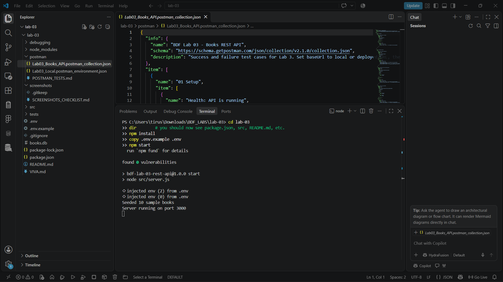
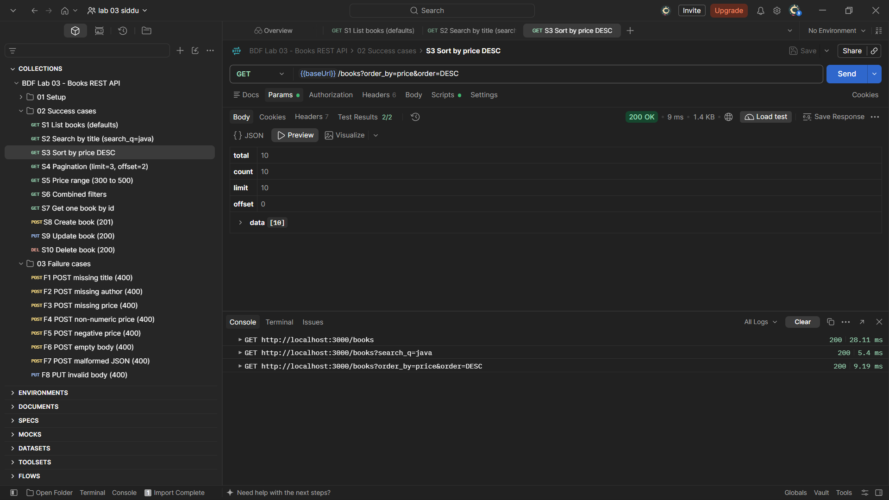

# Lab 3: REST API, query parameters, validation, debugging

**Name:** YOUR NAME HERE · **Registration number:** YOUR REG NO HERE · **Section:** YOUR SECTION HERE

**Live link:** PASTE_YOUR_PUBLIC_URL_HERE
*(If the project could not be deployed, replace this line with the reason, e.g. "Not deployed: free hosting was unavailable. Postman screenshots of every endpoint are shown below.")*

---

## How to run

**Requirements:** Node.js 18 or newer.

```bash
# 1. Go into the lab folder
cd lab-03

# 2. Install dependencies
npm install

# 3. Create your environment file (never commit .env)
cp .env.example .env

# 4. Start the server (creates and seeds books.db on first run)
npm start
```

The server runs at `http://localhost:3000`.

**Environment variables** (see `.env.example`, no real values are committed):

| Variable | Meaning | Default |
| --- | --- | --- |
| `PORT` | Port the server listens on | `3000` |
| `DB_PATH` | Path of the SQLite database file | `./books.db` |

**Other commands**

| Command | What it does |
| --- | --- |
| `npm run dev` | Start with auto-restart on file changes |
| `npm run seed` | Insert the 10 sample books (only if the table is empty) |
| `npm test` | Run the 17 automated tests (uses an in-memory database) |

---

## Endpoints

All endpoints are nouns (`/books`) and the HTTP method shows the action. Every error is returned as `{ "message": "..." }`.

| Method | Path | Description | Success | Failure |
| --- | --- | --- | --- | --- |
| GET | `/` | Health check, confirms the API is running | 200 | - |
| GET | `/books` | List books with search, filters, sorting and pagination | 200 | 400 |
| GET | `/books/:id` | Get a single book by id | 200 | 400, 404 |
| POST | `/books` | Create a book (`title`, `author`, `price`) | 201 | 400 |
| PUT | `/books/:id` | Update a book (`title`, `author`, `price`) | 200 | 400, 404 |
| DELETE | `/books/:id` | Delete a book | 200 | 400, 404 |

### Query parameters for `GET /books`

| Parameter | Meaning | Default | Rules |
| --- | --- | --- | --- |
| `search_q` | Partial, case-insensitive match on title (`LIKE`) | none | any text |
| `order_by` | Column to sort by | `id` | `id`, `title`, `author`, `price`, `created_at` |
| `order` | Sort direction | `ASC` | `ASC` or `DESC` (any case) |
| `limit` | Records per page | `10` | whole number, 1 to 100 |
| `offset` | Records to skip | `0` | whole number, 0 or more |
| `min_price` | Lowest price | none | number |
| `max_price` | Highest price | none | number, must be >= `min_price` |

Both `min_price` and `max_price` together use `price BETWEEN ? AND ?`. Either one alone uses `>=` or `<=`.

Example: `GET /books?search_q=java&min_price=200&max_price=800&order_by=price&order=DESC&limit=5&offset=0`

### Status codes used

| Code | When |
| --- | --- |
| 200 | Successful read, update or delete |
| 201 | Book created |
| 400 | Bad input: missing title or author, non-numeric price, bad query parameter, bad id, invalid JSON |
| 404 | The id does not exist, or the route does not exist |
| 500 | Unexpected server error (generic message, details only in the server log) |

### Sample responses

```json
// GET /books?limit=2            -> 200
{ "total": 10, "count": 2, "limit": 2, "offset": 0,
  "data": [ { "id": 1, "title": "Clean Code", "author": "Robert C. Martin", "price": 450, "created_at": "..." } ] }

// POST /books (valid)           -> 201
{ "message": "Book created successfully", "book": { "id": 11, "title": "...", "author": "...", "price": 349.99, "created_at": "..." } }

// POST /books (price: "abc")    -> 400
{ "message": "price must be a number" }

// GET /books/99999              -> 404
{ "message": "Book with id 99999 not found" }
```

---

## Screenshots

> Screenshots are stored in the `screenshots/` folder. See `screenshots/SCREENSHOTS_CHECKLIST.md` for what to capture and the exact file names.

### Server and success cases







### Failure cases


### Postman collection and database


### Debugging exercise


---

## Notes: problems faced and how I solved them

The full write-up with error messages and code changes is in [`debugging/DEBUGGING.md`](debugging/DEBUGGING.md). Summary:

| # | Problem | Error seen | Fix |
| --- | --- | --- | --- |
| 1 | Port conflict | `Error: listen EADDRINUSE: address already in use :::3000` | Stopped the old process (or changed `PORT`), read the port from `process.env.PORT`, and added a clear error handler on `server.on("error")` |
| 2 | Wrong import path | `Error: Cannot find module './db'` | The file is `database.js`, so the path was corrected to `./database` |
| 3 | Table-name typo | `SQLITE_ERROR: no such table: book` | Query changed from `FROM book` to `FROM books` |
| 4 | Missing `await` | Response was `{}` instead of the book | Added `await` before `db.get(...)` |

Design decisions:

- **Parameterised queries only.** Values go in `?` placeholders. Column names cannot be placeholders, so `order_by` and `order` are checked against a fixed whitelist before they are used in `ORDER BY`.
- **Safe `LIKE` search.** `%` and `_` typed by the user are escaped so they match literally.
- **Consistent errors.** One central error handler returns `{ "message": "..." }` for validation errors, unknown routes, bad JSON and unexpected errors.
- **Postman tests.** `postman/` has a collection of 32 requests (10 success, 21 failure, 1 health check) with automated assertions. See `postman/POSTMAN_TESTS.md`.
- **Viva preparation.** Short answers are in `VIVA.md`.

## Project structure

```
lab-03/
├── README.md
├── VIVA.md
├── package.json
├── .env.example
├── .gitignore
├── src/
│   ├── server.js            # starts the server, handles EADDRINUSE
│   ├── app.js               # builds the Express app
│   ├── db.js                # opens SQLite, creates the books table
│   ├── seed.js              # sample data
│   ├── routes/books.js      # all /books endpoints
│   └── middleware/          # validation and error handlers
├── tests/api.test.js        # automated tests (npm test)
├── postman/                 # collection, environment, test list
├── debugging/               # broken version, fixed version, write-up
└── screenshots/             # add your screenshots here
```
